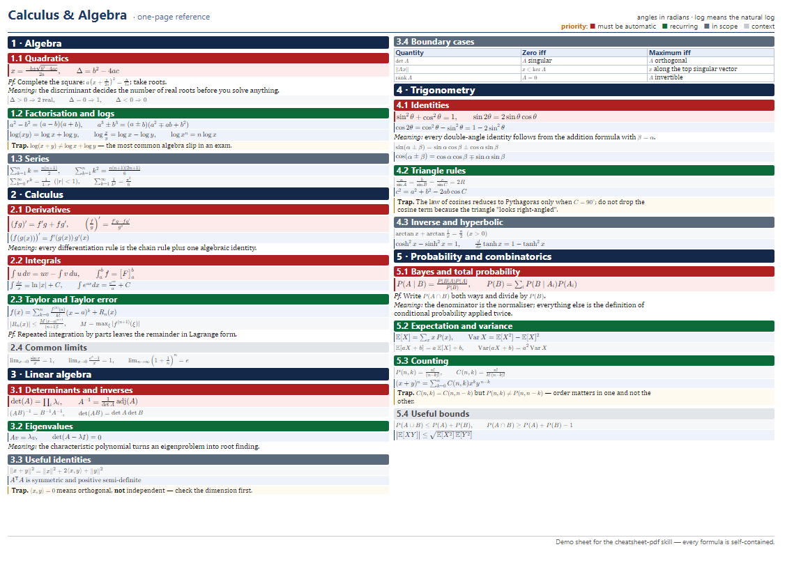
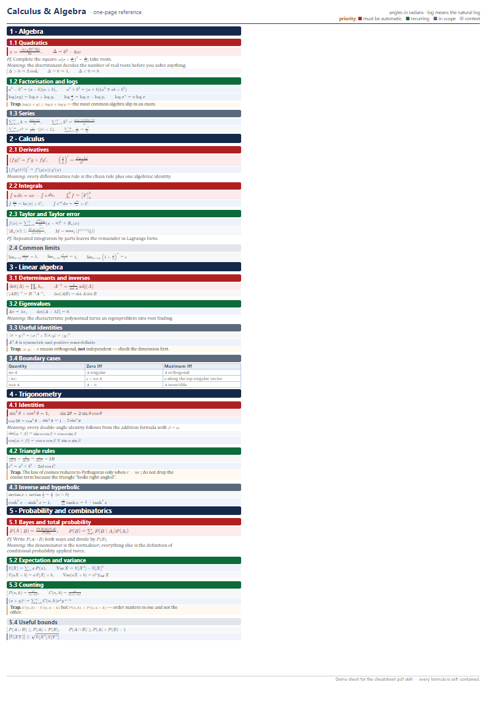

# cheatsheet-pdf-skill

**An agent skill that turns a body of course material into one dense A4 cheat sheet** — a PDF you
print and bring to an exam.

You write (or an AI writes) a Markdown cheat sheet; one command renders it to A4 landscape with real
LaTeX typesetting — one page or two, two by default — and verifies that nothing overflowed or was
clipped.

The skill directory, npm package and CLI keep the shorter name `cheatsheet-pdf`.



## Requirements

- **Node.js ≥ 18** — nothing else to install. KaTeX is vendored, and there are no runtime
  dependencies.
- **Chrome or Chromium** — used headlessly for layout measurement and PDF printing. Set
  `CHROME_PATH` if it is not in a standard location.

## Quick start

```bash
git clone <this-repo> cheatsheet-pdf
cd cheatsheet-pdf

# render the bundled example
npm run demo
npm run verify      # all gates must report PASS
```

To make your own, copy `skills/cheatsheet-pdf/templates/sheet-master.md`, fill it in following
the conventions below, then:

```bash
node skills/cheatsheet-pdf/scripts/cheatsheet.js my-sheet.md my-sheet.pdf --cols=5
node skills/cheatsheet-pdf/scripts/verify.js my-sheet.pdf
```

If you use an AI agent that can read files and run commands, point it at
[`skills/cheatsheet-pdf/SKILL.md`](skills/cheatsheet-pdf/SKILL.md) — it contains the full
two-stage workflow, including how to choose and rate content from past papers.

## How it works

Two stages, deliberately separated:

| Stage | Who | Output |
|---|---|---|
| **A. Author** | you, or an AI agent following `SKILL.md` | `<name>.md` |
| **B. Render** | `cheatsheet.js` — one command | `<name>.pdf`, one A4 landscape page |

Stage B runs: Markdown → HTML (math protected from Markdown formatting) → KaTeX typesetting →
over-wide formula fitting → column measurement → headless-Chrome printing → hairline fix-up. The
final step exists because Chrome rounds every sub-point rule up to a full point when exporting,
which prints fraction bars about five times too heavy.

Intermediates go to `<output-dir>/.cheatsheet/`, which is gitignored and safe to delete.

## Writing the Markdown

The conventions are carried by
[`templates/sheet-master.md`](skills/cheatsheet-pdf/templates/sheet-master.md) — copy it. In short:

| Write | Renders as |
|---|---|
| `# Title` | header title (one line); `> **Meta:**` is the short right-hand note, `> **Footer:**` the line under the columns |
| `# 1 · Topic` | chapter bar |
| `## ★★★ 1.1 Section` | section; stars set the colour (★★★ red, ★★ green, ★ grey, ☆ light grey) |
| `$$!formula$$` | core result — pink box, largest math |
| `$$formula$$` | standard formula — blue box |
| `$$?formula$$` | supporting formula — grey box, smallest math |
| `$x$` | inline math |
| `*Pf.* …` / `*Meaning:* …` / `> **Trap.** …` | proof sketch / exam sentence / warning box |

**Keep the teaching order.** Do not reorder by importance; the star ratings carry the priority
signal. Rate topics by evidence — how often they appear in past papers and how many marks they
carry — not by intuition.

## Capacity dials

Two numbers control how much fits on each page — and therefore how much content a given page count
holds:

| Flag | Meaning | Default |
|---|---|---|
| `--cols` | number of columns | 6 |
| `--base` | base (prose) font size in pt | 5.5 |
| `--gap` | column gutter in mm | 1.9 |
| `--math` | math size relative to prose | from stylesheet |
| `--css=<file>` | append a stylesheet on top of `sheet.css` | off |
| `--no-print` | measure only, no PDF | off |
| `--split` | experimental formula line breaking | off |
| `--thin` | printed hairline thickness in pt; `0` disables | 0.25 |
| `--quiet` | warnings and the final summary only | off |
| `--help`, `--version` | usage / version, then exit | — |

Content does not fit → raise `--cols` or lower `--base`. Page looks half empty → the reverse.
Change one dial, re-run, re-measure; two or three passes converge.

The dials are content-dependent, so there is no universal table — measure your own sheet. As a
reference point, the bundled demo (a 4.9 KB Markdown file) fills two columns comfortably at
`--cols=2 --base=8`, and its last column sits at about 80–90 % full. `--no-print` is the cheap way
to test a change: it measures without printing.

**The measure step tells you which way to turn a dial.** It prints an `ADVICE:` line based on what
it just measured — sparse, overflow, or a good fit — so one or two passes are normally enough
instead of a parameter sweep:

```
[measure] COL=2 FILL=40 ... ADVICE: content fills only 1.40 of 5 columns - sparse.
          Enlarge the type with --base.  Safe start: --base=10.1; a formula-heavy sheet may need more.
```

## Customising

Everything visual lives in one file: [`sheet.css`](skills/cheatsheet-pdf/scripts/sheet.css). Change a
value, re-run `cheatsheet.js`, then `verify.js`. Reference the rules by **selector** — line numbers
drift.

| Want to change | Edit this rule | Notes |
|---|---|---|
| Paper size or orientation | `@page { size: … }` **and** `.page { width/height }` | Change both: `@page` sets the PDF box, `.page` sets the layout box. Do it in an overlay file and pass `--css=`; see [`examples/portrait.css`](examples/portrait.css). |
| Number of columns | `--cols` (or `.flow { column-count }`) | Prefer the flag. Fewer columns = wider ones; for formula-heavy sheets that alone can fill the page. |
| Text size | `--base` (or `.page { font-size }`) | Everything else is in `em`, so one number moves the whole sheet. |
| Math size | `--math` (or the `.katex` rules under "Math sizing") | Math is sized per context. The hierarchy is measured against **inline math in prose** (the 0.85 em reference) — the grey supporting formula must not come out smaller than that. Boxed math may sit below the body text size; that is deliberate. |
| Body typeface | `.page { font-family }` | Headings and captions use their own `font-family` (`h1`, `h2`, `th`, `.legend`). |
| Core-formula colour | `.fxc { background / border-left }` | `.fxd` is the standard formula box, `.fxs` the supporting one. |
| Section priority colours | `h2.p3`, `h2.p2`, `h2.p1`, `h2.p0` | ★★★, ★★, ★, ☆ respectively. The priority scale is **colour-only** — it does not change the font size. |
| Title, right-hand note, footer | the `> **Meta:**` / `**Footer:**` lines in the Markdown (a `> **Header:**` line adds a short subtitle after the title — keep it brief: a long one wraps the note and costs column height) | Or override with `SHEET_TITLE` / `SHEET_SUBTITLE` / `SHEET_META` / `SHEET_FOOTER`. |
| Chinese or Japanese text | wrap it in `<span class="zh">…</span>` | A CJK class is already defined (`.zh`); for another script add its family there. Chinese renders without it too — the class just pins the typeface. |

**`--css` appends, so an overlay only states what it changes.** The bundled portrait example is six
lines:

```bash
npm run demo:portrait        # examples/demo.md -> examples/demo-portrait.pdf
```



Portrait takes fewer, wider columns than landscape — here two at 6 pt fill the page, where three at
7.5 pt left a quarter of it empty.

## Verification

`verify.js` reports nine gates — no wrapped formula, no orphaned punctuation, math size hierarchy,
container not widened, last column not overflowing, hairlines thinned, exactly the requested page
count, A4
(either orientation; the report says which), math fonts embedded. All must pass before you print.

Each render stamps `.cheatsheet/build.json` with the PDF it produced. If you point `verify.js` at a
PDF whose sheet is not the one in that folder — rendering two variants from one directory leaves
only the last build there — it stops with an error instead of reporting gates for the wrong page.

One thing it cannot check: look at the rendered page. Crop the header, a formula-dense region and
the last column and confirm nothing is clipped.

## FAQ

**The last column is cut off.** Content exceeded the available height; it creates a column beyond
the page instead of shrinking. Cut prose, or lower `--base`.

**A formula wrapped onto two lines.** It is wider than its column. Split it into two `$$` blocks
at an `=` so the second line starts with `=`, or shorten it.

**Chrome not found.** Set `CHROME_PATH` to the executable. The tool searches the usual Windows,
macOS and Linux install locations and then `PATH`.

**Can I have more than one page?** Yes — `--pages=<n>`, default **2** (a double-sided A4 sheet).
A page is a fixed box, so the content is distributed over exactly that many pages rather than left
to the printer: what does not fit is reported with the amount to cut and the low-priority sections
to cut first, and content shorter than the budget still prints the requested pages (the spare ones
are reported as thin). `--pages=3` works the same way.

**The page is only half full.** The `ADVICE:` line says which way to turn a dial. For a
formula-heavy sheet, using fewer, wider columns often fills it exactly; otherwise enlarge `--base`.
If the advice says *"content is thin for one page"*, the material genuinely does not fill a page —
add topics rather than inflating the type.

**A formula had to be shrunk to fit.** `fit-formulas.js` scales a formula that is wider than its
column and warns when the scale drops below 72 %, because below that it is no longer readable. Fix
it in the Markdown: split the formula into two `$$` blocks at an `=`, or shorten it.

**The fraction bars print too heavy or too faint.** They are rewritten to `--thin` pt (default
0.25) after printing, because Chrome rounds every sub-point rule up to a full point. Raise it to
0.3 if the lines look faint, or pass `--thin=0` to see the raw output.

**Non-Latin text.** Chinese renders out of the box — the font stack falls back to a CJK family
installed on the system. To pin a specific typeface, wrap the text in
`<span class="zh">…</span>`, which uses a class already defined in
[`sheet.css`](skills/cheatsheet-pdf/scripts/sheet.css); for another script, add its family there or
override `.page { font-family: … }` with `--css=`. If glyphs are missing entirely, no font on the
machine covers that script.

**The preview looks cut off.** It should not: the preview window is sized from the page geometry.
If it ever is, the sheet itself is fine — check the PDF, not the PNG.

## Design notes

1. **Capacity is the real problem.** A fixed page and elastic content means the font size and the
   content volume are the only two dials; the pipeline turns that into a measurement loop instead
   of guesswork.
2. **Formula boxes are atomic.** A KaTeX formula cannot break, so every formula has to fit one
   column — which is why the authoring rules insist on splitting long formulas at an `=`. A `$$`
   box that is still too wide is scaled down automatically; inline `$…$` is never scaled, so a long
   one in prose or a table cell bleeds into the next column.
3. **Conservative line breaking is the default.** Letting the browser decide where formulas break
   orphans fragments mid-formula; `--split` offers a smarter mode that is not yet fully settled.

## License

Not decided yet — no licence file is shipped for now. Bundled [KaTeX](https://katex.org/) is MIT
licensed; see `skills/cheatsheet-pdf/scripts/vendor/`.
